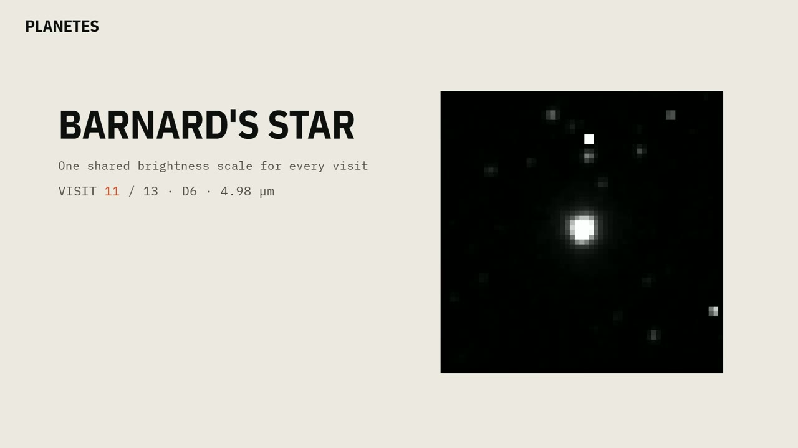
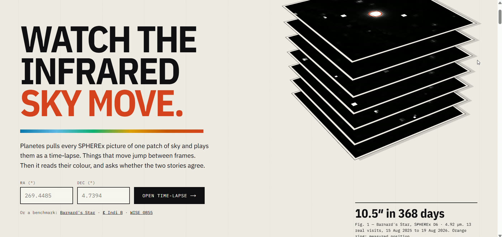
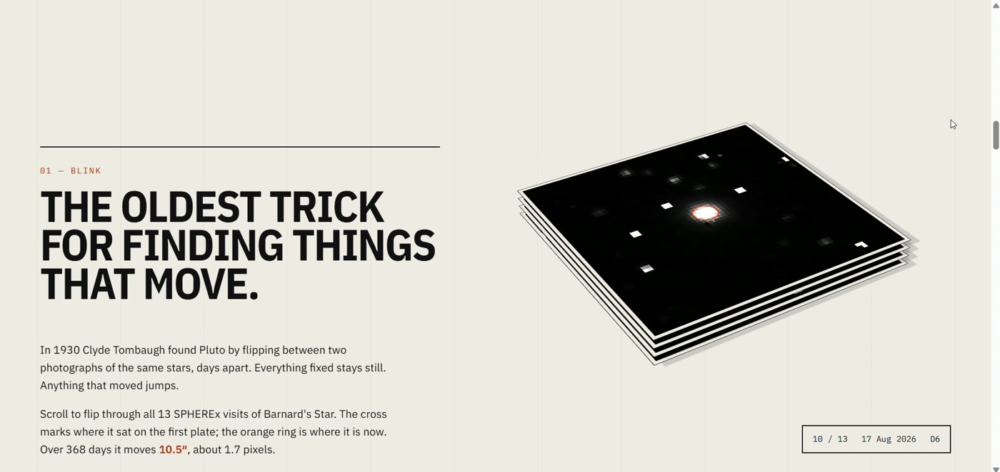
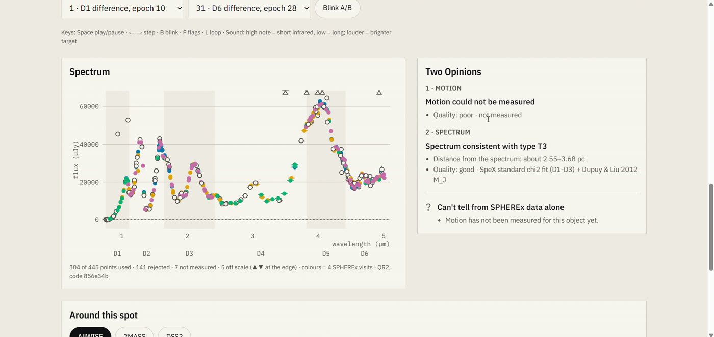
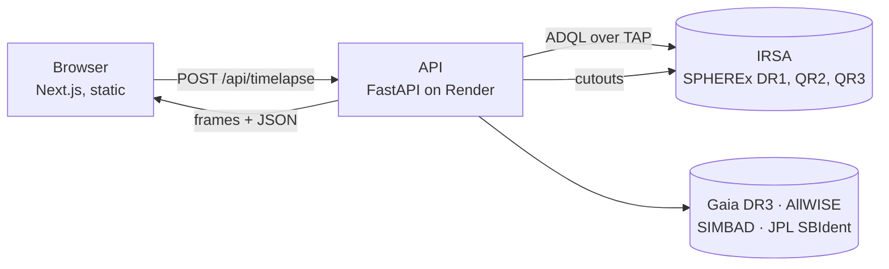

<div align="center">

# Planetes

### Watch the infrared sky move.

A public web tool for the NASA Space Apps Challenge 2026 challenge **Planet X and SPHEREx**.<br>
Type a position on the sky, and the available real NASA SPHEREx infrared images of it play as a time-lapse.

[](https://planetes.divergit.com)
[](https://planetes-api.onrender.com/api/health)
[](LICENSE)


[](docs/media/planetes-demo.mp4)

**▶ [Watch the 29-second film](docs/media/planetes-demo.mp4)**: every frame, spectrum point and number in it is real SPHEREx data from the site.

[Live site](https://planetes.divergit.com) · [Validation results](docs/VALIDATION.md) · [How it works](#how-it-works) · [Run it locally](#run-it-locally)

</div>

---

## Why

Pluto was found by blinking two photographs of the same patch of sky: everything fixed stays still, anything that moved jumps. NASA's SPHEREx now maps the whole sky every six months in 102 infrared colours, far too much for anyone to blink by hand.

Planetes does the blinking for any position, on real archive data. For an object it then forms **two complementary opinions** (how it moves, and what its spectrum says) and tells you whether they fit together. It is honest about what the data can and cannot show: results are "consistent with", never "discovered".

## What it does

| | Feature | Where |
|:-:|---|---|
| ▶ | **Time-lapse of any sky position**: the available SPHEREx exposures of that spot (Data Release 1, Quick Releases 2–3), north up, one shared brightness scale, with each frame's detector, wavelength and SPHEREx's own quality flags | `/viewer` |
| ⇄ | **Blink comparator**, plus **stack, difference and colour** views that make faint motion and colour changes visible | `/viewer` |
| ★ | **Catalogue stars** from Gaia DR3 and AllWISE moved to each frame's date, and a sky-context map | `/viewer` |
| ◐ | **Spectrum from 0.75 to 5 µm** built from SPHEREx's own pixels, with every rejected point explained (saturation, flags, a neighbouring star) | `/viewer` |
| ⚖ | **Two Opinions**: the spectrum is matched to standard brown-dwarf and star spectra for a type and a distance, then checked against the motion. The verdict says *Agree*, *Disagree* or *Can't tell*, with reasons | `/viewer` |
| ☄ | **A real asteroid**: two SPHEREx frames of 1562 Gondolatsch, 3.2 hours apart, within 0.11 px of where JPL predicts it from SPHEREx's own position | homepage |
| ◎ | **Planet X calculator**: how bright a distant planet would look to SPHEREx and how far it would jump between visits | `/planet-x` |
| ✓ | **Validation page**: every measurement checked against a known answer, including the tests that have not passed yet | `/validation` |
| ⧉ | Shareable URLs (`/viewer?ra=…&dec=…`), an embeddable view (`/embed`), a guided tour and an optional sound mode | |

The five challenge targets (Barnard's Star, ε Indi B, WISE 0855, RW Aurigae, R Draconis) are baked from real data and load instantly, even when the archives are down.

<table>
  <tr>
    <td width="33%"></td>
    <td width="33%"></td>
    <td width="33%"></td>
  </tr>
  <tr>
    <td align="center"><sub>Homepage</sub></td>
    <td align="center"><sub>Blink: Barnard's Star moving</sub></td>
    <td align="center"><sub>Spectrum and Two Opinions</sub></td>
  </tr>
</table>

## Results so far

Every result is checked against an answer astronomers already know. Full table with evidence: [docs/VALIDATION.md](docs/VALIDATION.md), also on the site at `/validation`.

| Test | Result | State |
|---|---|:-:|
| V1 Barnard's Star motion | 10.56 ± 0.33″/yr, PA 355.1° vs Gaia 10.39″/yr, 355.6° (1.6 %) | ✅ Pass |
| V4 Photometry | Median flux ratio 0.990 against 2MASS, 150 measurements of 3 unsaturated stars | ✅ Pass |
| V2 ε Indi B motion | 4.596 ± 0.032″/yr vs Gaia 4.684″/yr (1.9 %), from positions measured in 361 SPHEREx frames | ✅ Pass |
| V5 Brown-dwarf typing | ε Indi B typed T3 (unresolved T1+T6 pair), 2.55–3.69 pc vs 3.64 pc from Gaia | ✅ Pass |
| V6 Known asteroids | 15 of 17 found in 20 ecliptic fields, median offset 0.11 px | ✅ Pass |
| V8 Variables | R Dra and RW Aur correctly labelled "Can't tell: saturated" | ✅ Pass |
| V9 False-alarm control | At most 1 fake mover per field over 100 date shuffles | ✅ Pass |
| V10 Reproducibility | Same type and distance on a clean re-bake | ✅ Pass |
| V3 WISE 0855 · V7 asteroid thermometer | V3 run: not measurable (blended with a Gaia star); V7 run in progress | 🟡 In progress |

Every image on the site is real SPHEREx data from NASA/IPAC IRSA. Nothing is simulated.

### What is not done yet, and why

| Test | What is missing | Why |
|---|---|---|
| V3 WISE 0855 motion | A usable motion | Run done: a Gaia star blends with it in all 45 D6 frames, so no motion is claimed; needs a two-star fit |
| V7 thermometer | The test on ≥ 20 real asteroids against JPL distances | Running: each of the 20 ecliptic fields needs a SPHEREx search plus a JPL lookup per exposure, and IRSA's main search (TAP) times out on each one before the SIA fallback answers |

IRSA's main SPHEREx search (TAP) has been returning errors ("502 Proxy Error") or timing out on IRSA's own servers, for every user. Planetes now falls back to IRSA's image search (SIA), which lists the same SPHEREx frames, so these runs can go ahead; V4 has already run this way. The scripts for all four tests are in [pipeline/notebooks/](pipeline/notebooks/) with their pass rules written down before any run; they will be run as soon as the service answers, and the results go on the Validation page whether they pass or not.

## How it works



1. **Find:** an ADQL query to IRSA's TAP service lists the SPHEREx exposures covering the position (up to the pipeline's frame limit). Fast-moving stars are first moved to each frame's date with Gaia DR3 proper motions.
2. **Fetch:** only small cutouts are downloaded, in parallel, and cached.
3. **Process:** zodiacal light is subtracted, each frame is resampled onto one north-up grid (flags are never interpolated), and all frames share one asinh stretch.
4. **Measure:** forced aperture photometry at the target in every frame gives a spectrum across SPHEREx's six detectors. Saturated and flagged points are shown but never used.
5. **Judge:** the spectral typer (SpeX standards) or the asteroid thermometer (NEATM fitted to the D6/D3 ratio) gives a distance, and the verdict engine checks it against the motion.

Every number keeps its SPHEREx observation ID. IRSA stays the main source, and when an outside service is down the site says so and switches to a real backup: the header badge runs a real IRSA search; a typed position whose search fails shows the SPHEREx DR1 all-sky map and a 102-colour spectrum from [NASA's open-data copy on AWS](https://irsa.ipac.caltech.edu/cloud_access/), with a pop-up explaining what failed and what is missing (no visit-by-visit time-lapse); and the sky map falls back from ESA ESASky to copies of the same surveys at IRSA, CSIRO and CDS.

**Stack:** Python 3.11 (Astropy, astroquery, pyvo, photutils, NumPy, SciPy, FastAPI) · TypeScript (Next.js, React, three.js) · Aladin Lite · JSON Schema contracts shared by both sides · Vercel and Render.

## What SPHEREx can and can't show

- Bright stars saturate SPHEREx (roughly brighter than AB 11.7 at short wavelengths). Barnard's Star, R Draconis and RW Aurigae are affected: their saturated points are shown but never used in a verdict.
- One SPHEREx pixel is about 6″, so the yearly parallax wobble of these stars is under a tenth of a pixel. We do not claim to measure parallax.
- WISE 0855 is almost invisible below 3.5 µm; it tests the faint limit.
- A proposed Planet Nine would be around V 19–24, fainter than one SPHEREx visit reaches. The Planet X page shows why, with its numbers labelled as what-ifs.

## Run it locally

Needs Python 3.11, Node 22 (see `web/.nvmrc`) and GNU Make. Commands run from the repo root unless noted.

**Python package and API**
```bash
python3.11 -m venv .venv            # or: uv venv --python 3.11 .venv
source .venv/bin/activate           # Windows: .venv\Scripts\activate
pip install -e "pipeline[dev]" -r api/requirements.txt
ALLOWED_ORIGINS=http://localhost:3000 uvicorn api.main:app --reload --port 8000
```
Then open http://localhost:8000/api/health. Optional environment variables: `ALLOWED_ORIGINS` (comma-separated; unset means no cross-origin access) and `GIT_COMMIT`.

**Web**
```bash
cd web
cp .env.example .env.local          # NEXT_PUBLIC_API_BASE=http://localhost:8000
npm ci
npm run dev                         # http://localhost:3000
```

**Contracts** (JSON Schemas in `contracts/` are the source of truth)
```bash
make contracts    # regenerate pipeline/src/planetes/contracts.py and web/src/types/contracts.ts
make validate     # validate every JSON file in web/public/data against its schema
```

**Tests and checks**
```bash
cd pipeline && pytest -q -m "not network"   # add -m network for tests that call IRSA
ruff check pipeline api contracts
cd web && npm run lint && npm run typecheck && npm run test && npm run build
```

**Re-bake a benchmark from real data:** `python -m api.bake --spectrum epsindib` (see [docs/RUNBOOK.md](docs/RUNBOOK.md)).

## Repository

```
api/          FastAPI service: time-lapse jobs, frames, spectrum, opinions, health, bake scripts
pipeline/     Python package `planetes`: data access, frames, stacks, photometry, spectrum, typer,
              thermometer, motion, known asteroids, verdict; tests; validation notebooks
web/          Next.js site; web/public/data holds the baked benchmark targets
contracts/    JSON Schemas shared by API and web (generated Python and TypeScript types)
docs/         product, technical, API, science and design docs; validation results, evidence, media
```

| Doc | What it covers |
|---|---|
| [01 PRD](docs/01-PRD.md) | What we built and why; features mapped to the challenge's considerations |
| [02 TRD](docs/02-TRD.md) | Architecture, hosting, SPHEREx data gotchas, stack |
| [03 Data Contract & API](docs/03-Data-Contract-API.md) | URL parameters, endpoints, JSON shapes |
| [04 Science & Validation](docs/04-Science-Validation.md) | Targets, Two Opinions physics, tests V1–V10 |
| [09 Design & Brand](docs/09-Design-and-Brand.md) | Palette tokens, typography, layout |
| [Validation results](docs/VALIDATION.md) | Every test with its pass mark, result and evidence |
| [Runbook](docs/RUNBOOK.md) | Deploy, bake and operate |
| [References](docs/REFERENCES.md) | Every data source, library and tool |
| [AI usage](docs/AI_USAGE.md) | Which AI tools were used, for what, and how the output was checked |

## Data and credits

- **SPHEREx** Data Release 1 Spectral Images (doi:10.26131/IRSA678) and Quick Release Spectral Images QR2 and QR3 (doi:10.26131/IRSA652, IRSA662), from the [NASA/IPAC Infrared Science Archive](https://irsa.ipac.caltech.edu/Missions/spherex.html). Data access follows IRSA's [SPHEREx tutorial notebooks](https://caltech-ipac.github.io/irsa-tutorials/spherex/).
- **ESA Gaia DR3** and **AllWISE** (both via IRSA), **SIMBAD** and **Aladin Lite** (CDS, Strasbourg), sky images from **ESA ESASky** with copies at IRSA, CSIRO CASDA and CDS, **NASA JPL** Small-Body Identification and Horizons, the **SpeX Prism Library**.
- The blink control is inspired by [WiseView](http://byw.tools/wiseview) (no code used).
- Film music ("Free EDM Song" by Seth_Makes_Sounds) and sound effects: CC0 recordings from [Openverse](https://openverse.org).

This publication makes use of data products from the Spectro-Photometer for the History of the Universe, Epoch of Reionization and Ices Explorer (SPHEREx), which is a joint project of the Jet Propulsion Laboratory and the California Institute of Technology, and is funded by the National Aeronautics and Space Administration.

Full list: [docs/REFERENCES.md](docs/REFERENCES.md). AI tool use is disclosed in [docs/AI_USAGE.md](docs/AI_USAGE.md). Planetes is not an official NASA product and is not endorsed by NASA.

## Team Planetes

Rishabh Kataria (platform, integration, frontend) · Tirth (data and imaging, demo) · Shivaansh (motion and orbits) · Amish (thermometer and Planet X physics)

## Licence

MIT (see [LICENSE](LICENSE)). Third-party data and code keep their own licences.
